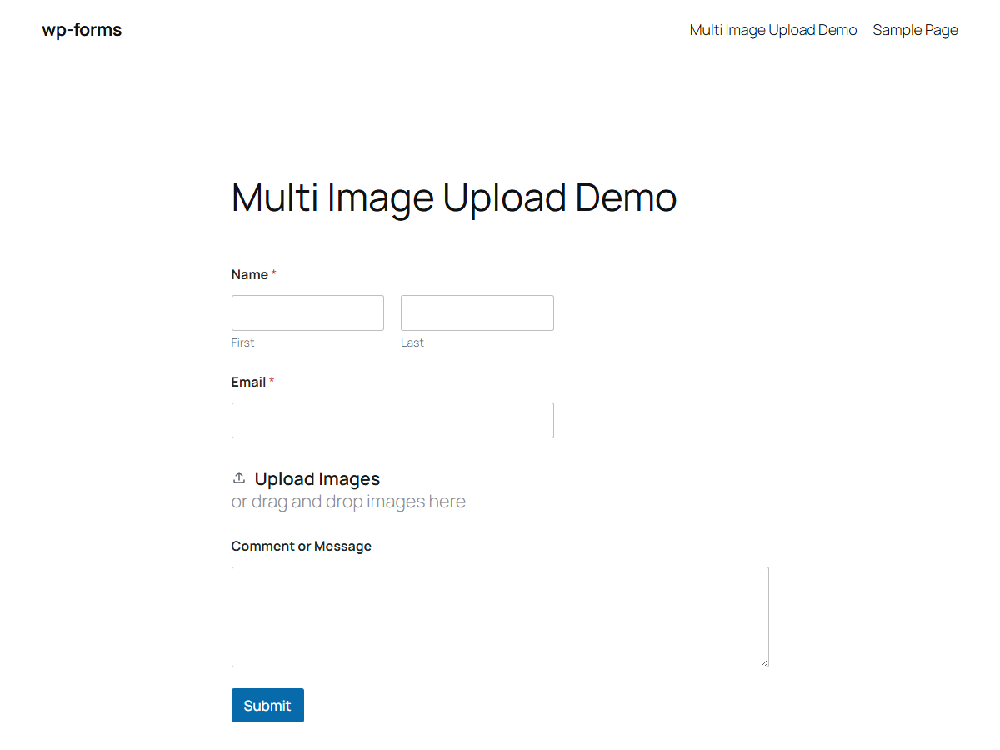
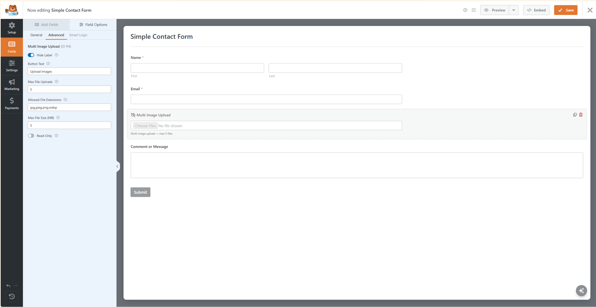

# Multimage – Multiple Image & Photo Upload for WPForms


**Add multiple image and photo uploads to WPForms Lite with instant AJAX uploads, custom limits, and email attachments. No Pro required.**

[](https://wordpress.org/plugins/multimage-image-uploads-for-wpforms/)
[](https://wordpress.org/plugins/multimage-image-uploads-for-wpforms/)
[](https://www.gnu.org/licenses/gpl-2.0.html)

WPForms Lite does not include an image or photo upload field. Multimage solves this completely free — adding a dedicated **Multi Image Upload** field that lets visitors attach multiple photos, screenshots, and images to any WPForms form with instant AJAX pre-upload and email attachments without purchasing WPForms Pro.

[](https://www.youtube.com/watch?v=XG80kG8uRe0)

**[Try it live in your browser](https://playground.wordpress.net/?plugin=wpforms-lite&plugin=multimage-image-uploads-for-wpforms&url=/wp-admin/admin.php%3Fpage%3Dwpforms-overview)** — no install required, via WordPress Playground.

**[Live on the WordPress Plugin Directory →](https://wordpress.org/plugins/multimage-image-uploads-for-wpforms/)**

## Features

- **Multi Image Upload Field** — easily drag and drop into any WPForms form from the Standard Fields panel
- **Built for WPForms Lite** — accept multiple image uploads on your forms without paying for a WPForms Pro license
- **Works with AJAX on or off** — images pre-upload instantly via AJAX on selection, ensuring zero data loss during form submission
- **Individual Remove Buttons** — visitors can preview selected photos and remove unwanted images before submitting
- **Custom Field Settings** — configure Button Text, Max File Uploads, Allowed File Extensions, and Max File Size (MB) directly in the builder
- **Email Attachments** — uploaded images are attached directly to WPForms notification emails
- **Email Template Integration** — image links are automatically included in the `{all_fields}` email tag
- **Strict Security & Validation** — server-side content-based MIME validation (images only), file extension whitelist, and size limit checks
- **Automatic Cleanup** — temporary uploads from abandoned form submissions are automatically deleted after 24 hours
- **Clean Media Library** — uploaded images are saved in your WordPress uploads folder without cluttering your WordPress Media Library

## Screenshots

| Front-end field | Field settings (builder) |
|---|---|
|  |  |

## How it works

When a visitor selects images, each file uploads immediately to a temporary folder through a secured AJAX endpoint. Lightweight tokens travel with the form submission, and on successful submission the files move into the standard WordPress uploads directory.

## Development

This repo includes the full development setup — PHPUnit tests with [Brain Monkey](https://github.com/Brain-WP/BrainMonkey) for mocking WordPress core functions:

```bash
composer install
vendor/bin/phpunit
```

Production releases are mirrored to the [WordPress.org SVN repository](https://plugins.svn.wordpress.org/multimage-image-uploads-for-wpforms/) — `trunk/` there is the canonical shipped source.

## Other Plugins by Me

Check out my other free plugins on the WordPress Plugin Directory:

* **[Flash Sale Stock Guard for WooCommerce](https://wordpress.org/plugins/flash-sale-stock-guard-for-woocommerce/)** — Stop overselling during limited drops and flash sales by reserving stock at add-to-cart.
* **[Quovex Blocks](https://wordpress.org/plugins/quovex-blocks/)** — Modern Gutenberg blocks: Filterable Query Grid, Post Carousel, Content Showcase & Notification Banner.
* **[Story Video Block](https://wordpress.org/plugins/story-video-block/)** — Fast video player, YouTube/Vimeo embed & video testimonials block for Gutenberg with click-to-play lazy loading.

## License

GPL-2.0-or-later. See [LICENSE](LICENSE).

---

*This is an independent, third-party add-on. It is not affiliated with, endorsed by, or sponsored by WPForms or Awesome Motive, Inc. "WPForms" is a trademark of its respective owner and is used here only to describe compatibility.*
